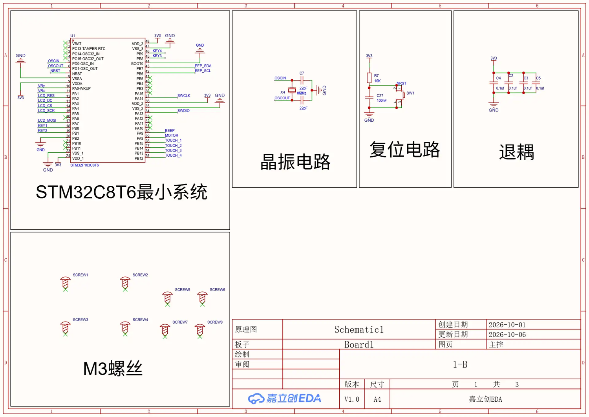
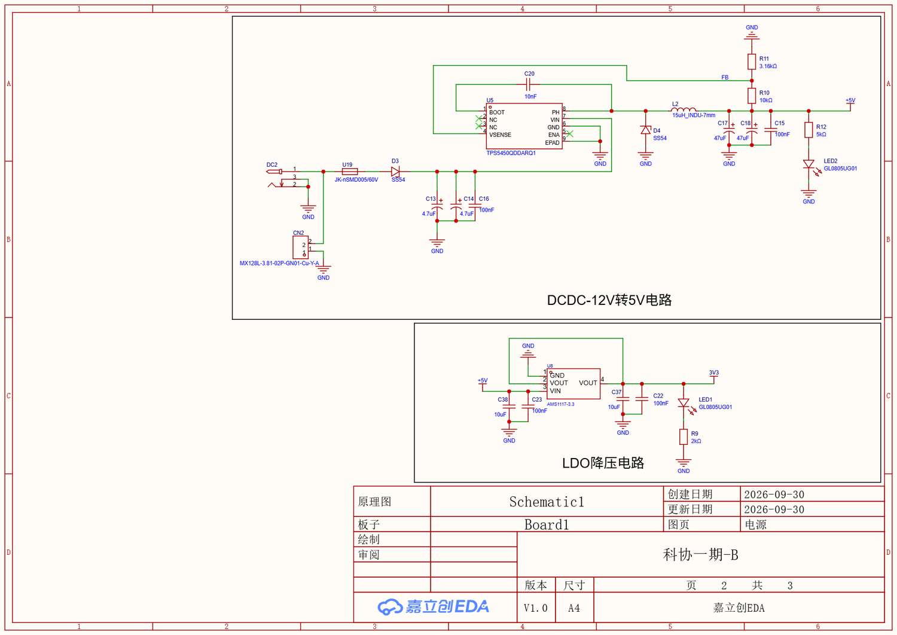
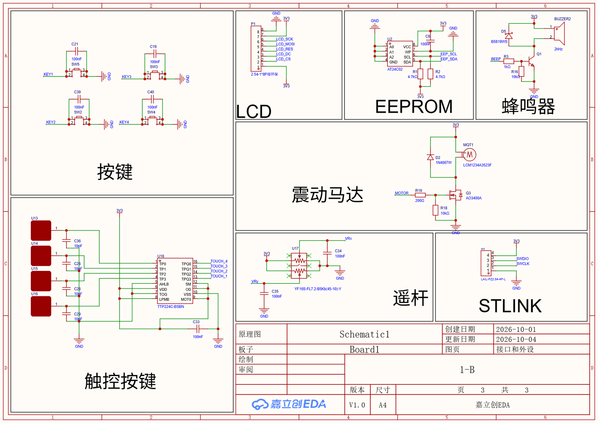
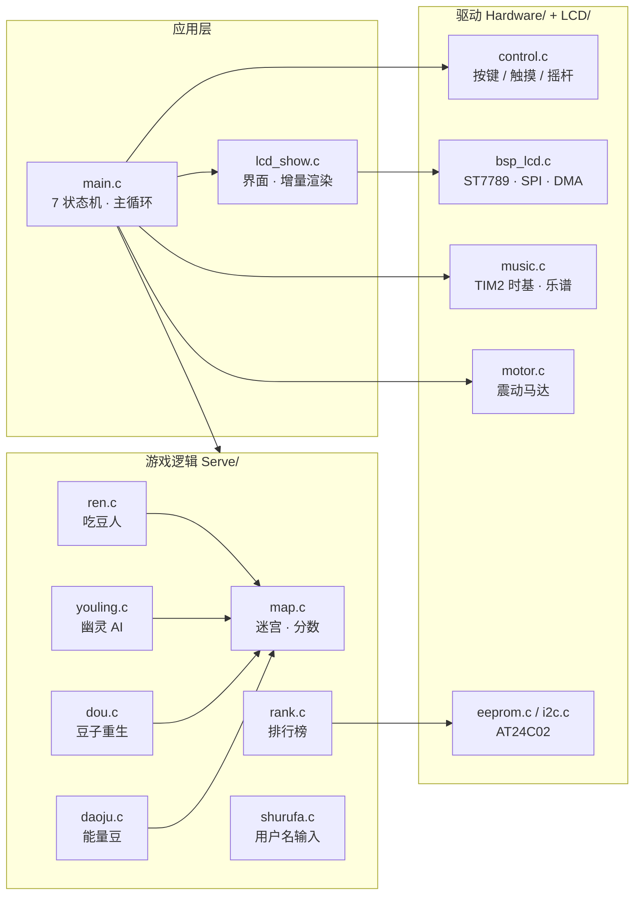

<div align="center">

# 🕹️ PAC-MAN 掌机

**基于 STM32F103C8T6 的自制吃豆人游戏机**<br>
原理图、PCB、固件全部自己做 —— 一台能捧在手里的 13×13 迷宫街机


</div>

---

## ✨ 这是什么

一块 STM32F103C8T6、一块 240×280 的 SPI 屏、一根摇杆、四颗按键、四路电容触摸，再加上蜂鸣器和震动马达 —— 就是一个完整的吃豆人街机。

游戏逻辑没有用任何引擎：迷宫、吃豆人、幽灵 AI、豆子重生、能量豆、排行榜、音效、界面，全部是裸机 C 代码，塞进 **34 KB Flash / 3.4 KB RAM** 里跑。

项目的硬件工程（嘉立创 EDA 专业版）和 Keil 固件工程都在这个仓库里，照着做可以复刻一台。

> **状态**：v1.0 · 原理图 / PCB / 固件已完成，固件编译 0 Error，可直接烧录。
>
> **说明**：仓库里的界面文案、变量名保留了制作时的原样（包括菜单里的 `Gay Mode`），没有为了开源重新包装。

<details>
<summary>English summary</summary>

A handheld Pac-Man clone built from scratch on an STM32F103C8T6: a 13×13 maze, BFS-chasing ghosts, power pellets, a local two-player mode, an EEPROM top-5 leaderboard, buzzer music, a vibration motor, and three input methods (buttons, capacitive touch, analog joystick). Schematics, PCB and bare-metal firmware are all included. Code size: 34 KB flash, 3.4 KB RAM. No RTOS, no game engine.

</details>

---

## 🎮 功能特性

**玩法**

- **13×13 迷宫**，吃豆 +10 分，能量豆 +50 分并进入 6 秒能量模式
- **3 只幽灵**：两只用 BFS 算最短路一路追你，一只随机游走 —— 追你的那两只还会错开出发时间
- **能量模式下幽灵变蓝逃跑**（朝着远离你的方向跑），撞上去 +100 分并把它打回巢，回巢后满血复活
- **豆子永远吃不完**：吃掉第 6 颗时，第 1 颗的位置会重新长出一颗豆
- **双人对战**：一个人用摇杆操控吃豆人，另一个人用按键操控幽灵，清空豆子、各一条命、一局定胜负
- **3 条命**，被抓后本回合重开（分数保留），生命耗尽进入结算并写入排行榜

**操作与反馈**

- 三种输入并存：**4 颗轻触按键 + 4 路 TTP224 电容触摸 + 双轴模拟摇杆**
- 摇杆上电自动校准（16 次采样取中心，同时检查量程和抖动，装歪了不会乱走）
- 被抓 / 死亡时**震动马达**抖 150 ms
- 无源蜂鸣器播放**开场曲、游戏循环 BGM、待机曲、按键音**

**界面**

- 7 个状态：标题、菜单、用户名输入、排行榜、设置、游戏中、结算
- **Top5 排行榜**存进 AT24C02，掉电不丢；破纪录显示 `NEW RECORD!`，进前五显示 `TOP 5!`
- 设置里可切换**深色 / 浅色**（ST7789 显示反转）和**音乐开关**
- 游戏内 HUD 实时显示分数、剩余生命、FPS
- 角色按时间做**像素级插值**移动，不是一格一格跳；画面用**脏矩形**增量刷新，最高约 125 FPS

---

## 🔧 硬件

### 主要器件

| 类别 | 型号 | 说明 |
| --- | --- | --- |
| 主控 | **STM32F103C8T6** | Cortex-M3 @72 MHz，64 KB Flash / 20 KB SRAM，LQFP48 |
| 显示 | **ST7789V** 240×280 | SPI，RGB565，显存 240×320，可见区竖向偏移 20 行 |
| 存储 | **AT24C02** | 256 B EEPROM，软件 I2C，存排行榜 |
| 输入 | 4× 轻触按键 | KEY1 ~ KEY4 |
| 输入 | **TTP224C-BSBN** | 4 通道电容触摸，输出高有效 |
| 输入 | 双轴电位器摇杆 | ADC 采样，X/Y 各一路 |
| 声音 | 无源蜂鸣器 + S8050 | TIM1_CH2 PWM 驱动 |
| 反馈 | 震动马达 + AO3400A | GPIO 控制 MOS 管 |
| 电源 | **TPS5450** → **AMS1117-3.3** | 12 V DC 输入 → 5 V → 3.3 V |
| 调试 | 4 Pin SWD | ST-Link 下载调试 |
| 结构 | 8× M3 螺丝 | 8 处固定孔 |

### 硬件框图

```text
12V DC ──▶ TPS5450 (Buck) ──▶ 5V ──▶ AMS1117-3.3 ──▶ 3.3V
                                                  │
STM32F103C8T6 ◀───────────────────────────────────┘
      │
      ├─ SPI1 ─────▶ ST7789  240×280
      ├─ ADC1 ─────▶ 摇杆 X/Y（PA0 / PA1）
      ├─ GPIO ─────▶ 4 按键（PB0/PB1/PB8/PB9）+ TTP224 触摸（PB12~PB15）
      ├─ TIM1_CH2 ─▶ 无源蜂鸣器（PA9）
      ├─ GPIO ─────▶ AO3400A ─▶ 震动马达（PA8）
      ├─ I2C 软件 ─▶ AT24C02（PB6 / PB7）
      └─ SWD ──────▶ ST-Link（PA13 / PA14）
```

### 引脚分配

| 功能 | 引脚 | 说明 |
| --- | --- | --- |
| 摇杆 X / Y | PA0 / PA1 | ADC1_IN0 / IN1，上电自动校准 |
| LCD RST | PA2 | GPIO 推挽 |
| LCD DC | PA3 | 数据 / 命令选择 |
| LCD CS | PA4 | 片选（软件 NSS） |
| LCD SCK | PA5 | SPI1_SCK |
| LCD MOSI | PA7 | SPI1_MOSI |
| 震动马达 | PA8 | 高电平导通 AO3400A |
| 蜂鸣器 | PA9 | TIM1_CH2 PWM，50% 占空比 |
| 按键 KEY1 | PB0 | 固件未映射（预留） |
| 按键 KEY2 | PB1 | 确认 / 右 |
| 按键 KEY3 | PB8 | 上 |
| 按键 KEY4 | PB9 | 下 |
| EEPROM SCL / SDA | PB6 / PB7 | 软件 I2C，10 µs 半周期 |
| 触摸 TOUCH_1 | PB15 | 上 |
| 触摸 TOUCH_2 | PB14 | 下 |
| 触摸 TOUCH_3 | PB13 | 左 / 返回 |
| 触摸 TOUCH_4 | PB12 | 右 / 确认 |
| SWDIO / SWCLK | PA13 / PA14 | ST-Link |
| 晶振 | PD0 / PD1 | 8 MHz |

> 引脚以固件为准；改动硬件时同步改 `software/Hardware/*.c` 和 `software/LCD/bsp_lcd.h` 里的宏即可。

### 原理图

硬件工程：`hardware/ProPrj_1-B_2026-11-18.epro2`（用 **嘉立创 EDA 专业版** 打开，含原理图 + PCB）。
下面是从工程里导出的三页原理图，方便直接看：

| ① 主控最小系统 | ② 电源 | ③ 接口与外设 |
| :---: | :---: | :---: |
| [](docs/hardware/schematic-1-mcu.png) | [](docs/hardware/schematic-2-power.png) | [](docs/hardware/schematic-3-io.png) |

点击图片可看大图（1500 px 宽）。

---

## 💻 软件

### 目录结构

```text
.
├── README.md
├── docs/hardware/                     # 由 EDA 工程导出的原理图
├── hardware/
│   └── ProPrj_1-B_2026-11-18.epro2    # 嘉立创 EDA 专业版工程（原理图 + PCB）
└── software/
    ├── Project.uvprojx                # Keil MDK 工程
    ├── User/                          # main.c 状态机、中断入口、库配置
    ├── Serve/                         # 游戏逻辑：迷宫、吃豆人、幽灵、豆子、道具、排行榜、输入聚合
    ├── Hardware/                      # 按键、触摸、摇杆、蜂鸣器、音乐、马达、EEPROM、软件 I2C
    ├── LCD/                           # ST7789 驱动、字库、界面与游戏渲染
    ├── System/                        # 延时
    ├── Start/                         # 启动文件、CMSIS、寄存器定义
    ├── Library/                       # STM32F10x 标准外设库 V3.5.0
    └── keilkill.bat                   # 一键清理 Keil 中间文件
```

### 架构



### 状态机

`main.c` 里就是一个 `while(1)` + `switch(g_state)`，没有 RTOS：

| 状态 | 界面 | 出口 |
| --- | --- | --- |
| `ST_TITLE` | 标题 + 四个菜单项 | START → 名字输入；Gay Mode → 双人；RANK / SETTING |
| `ST_MENU` | 菜单 | 与标题页同一套选项 |
| `ST_NAME` | 8 字符用户名输入 | 长按右 → 开始游戏；左 → 返回 |
| `ST_RANK` | Top5 排行榜 | 确认 / 返回 → 菜单 |
| `ST_SETTING` | 深色模式、音乐开关 | 确认切换；返回 → 菜单 |
| `ST_PLAY` | 游戏 | 生命耗尽 / 双人分出胜负 → `ST_OVER` |
| `ST_OVER` | 结算（分数、纪录提示） | 确认 → 菜单 |

### 调度与时序

整个项目只有一个 1 ms 硬件时基（TIM2），所有节奏都由它派生：

| 任务 | 周期 | 位置 |
| --- | --- | --- |
| 系统时基 `g_tick_ms` / 音乐状态机 | 1 ms | `music.c`（TIM2 中断） |
| 吃豆人移动 | 140 ms / 格 | `REN_MOVE_MS` |
| 吃豆人插值动画 | 100 ms | `REN_ANIM_MS` |
| 幽灵移动 | 270 ms / 格 | `YL_MOVE_MS` |
| 能量豆倒计时 | 100 ms / tick × 60 = **6 s** | `POWER_DEC_MS` / `POWER_TICKS` |
| 道具重生检查 | 10 s 后随机空地重生（仅双人模式启用） | `DAOJU_RESPAWN_MS` |
| 画面刷新 | 最快 8 ms 一帧（约 125 FPS） | `Game_StepScreen()` |
| 触摸消抖 | 10 ms | `touch.c` |
| 按键消抖 | 20 ms | `key.c` |

### 关键参数

| 参数 | 值 | 位置 |
| --- | --- | --- |
| 迷宫尺寸 | 13 × 13，格宽 16 px | `map.h` / `lcd_show.h` |
| 地图绘制原点 | (15, 59) | `MAP_X0` / `MAP_Y0` |
| 初始生命 | 3 | `REN_LIFE_MAX` |
| 吃豆 / 能量豆 / 吃幽灵 | +10 / +50 / +100 | `ren.c` / `main.c` |
| 豆子重生队列 | 5 格环形队列 | `dou.c` |
| 幽灵数量 / 出生等待 | 3 只 / 0、6、12 拍 | `YL_WAIT` |
| 能量豆位置（单人） | (3,1)、(3,11) | `daoju.c` |
| 长按判定 | 700 ms | `CONTROL_LONG_MS` |
| 死亡停顿 | 1200 ms + 震动 150 ms | `main.c` |
| EEPROM 布局 | 0x00 magic `0xA5`，0x01 起 5×12 B | `rank.c` |

---

## 🛠️ 编译与烧录

### 环境

| 项目 | 版本 |
| --- | --- |
| IDE | Keil MDK 5.42（μVision 5） |
| 编译器 | **ARM Compiler 5**（V5.06 update 7）—— 工程 `uAC6 = 0`，用 AC5 编译 |
| 器件包 | Keil.STM32F1xx_DFP 2.2.0 |
| 外设库 | STM32F10x Standard Peripheral Library V3.5.0（已随仓库提供） |
| 下载器 | ST-Link（SWD 四线） |

### 步骤

```bash
git clone https://github.com/<your-name>/pacman-stm32.git
```

1. 用 Keil 打开 `software/Project.uvprojx`
2. `F7` 编译（工程已包含 `Start / Library / User / System / Hardware / LCD / Serve` 的头文件路径）
3. ST-Link 接 SWD（3V3 / GND / SWDIO / SWCLK），`F8` 下载
4. 上电，屏幕亮起进入标题页

> 只想要固件？用 `fromelf` 从 `software/Objects/Project.axf` 转出 hex：
>
> ```bash
> fromelf --i32 --output=Project.hex software/Objects/Project.axf
> ```
>
> 然后用 STM32CubeProgrammer 烧录。

### 资源占用（当前构建）

```text
Code = 19096 B    RO-data = 15740 B    RW-data = 228 B    ZI-data = 3244 B
Flash ≈ 34.2 KB / 64 KB        RAM ≈ 3.4 KB / 20 KB
```

字库（`lcdfont.h`）占了 RO-data 的大头，想再省 Flash 可以只保留 12/16 号字。

---

## 🕹️ 操作说明

### 输入映射

| 动作 | 物理按键 | 触摸 | 摇杆 |
| --- | --- | --- | --- |
| 上 / 上一项 / 上一个字符 | KEY3（PB8） | TOUCH_1（PB15） | 上 |
| 下 / 下一项 / 下一个字符 | KEY4（PB9） | TOUCH_2（PB14） | 下 |
| 右 / 确认 / 光标后移 | KEY2（PB1） | TOUCH_4（PB12） | 右 |
| 左 / 返回 / 光标前移 | — | TOUCH_3（PB13） | 左 |

- 三种输入在 `control.c` 里聚合，优先级：**按键 > 触摸 > 摇杆**
- 名字输入界面**长按右键 700 ms** 直接开始游戏（不足 8 位也照开，跳过的位是空格）
- 双人模式：**摇杆只控制吃豆人，物理按键只控制幽灵**（触摸不参与对战）

### 菜单

标题页 / 菜单页四个选项：

| 选项 | 作用 |
| --- | --- |
| `START` | 单人游戏（先输入用户名，长按右键开始） |
| `Gay Mode` | 双人对战（清空豆子，吃豆人 vs 幽灵） |
| `RANK` | 查看 Top5 排行榜 |
| `SETTING` | 切换深色 / 浅色、开关音乐 |

### 用户名输入

字符集是 `A-Z 0-9 空格`，共 8 位：

- 上 / 下：切换当前位字符
- 右：确认当前位，光标后移（最后一位再按 = 输入完成）
- 左：光标前移
- 长按右：开始游戏（输完 8 位不会自动开局，要靠这个长按）

---

## 📖 游戏规则

### 单人

- 吃掉一颗豆 **+10**，能量豆 **+50**
- 吃到能量豆后进入 **6 秒能量模式**：三只幽灵变深蓝并朝远离你的方向逃
- 能量模式中撞到幽灵：**+100**，幽灵被打回巢（回巢途中不参与碰撞），到巢后恢复正常
- 非能量模式撞到幽灵：掉一条命，**本回合重开**（豆子铺满、分数保留），停顿 1.2 s 并震动
- 吃掉第 6 颗豆时，第 1 颗的位置会重新长出一颗 —— 地图不会越玩越空
- 生命耗尽 → 结算；分数进前五会写入 EEPROM 排行榜

### 双人（Gay Mode）

- 开局清空所有豆子，场上只留一颗能量豆
- 吃豆人一方用摇杆；幽灵一方用按键（上 / 下 / 右）
- 双方各一条命，**一局定胜负**：
  - 幽灵处于普通状态时碰到吃豆人 → 幽灵胜
  - 吃豆人吃到能量豆后撞到幽灵 → 吃豆人胜
- 双人模式**不计分、不进排行榜**；能量豆被吃后 10 秒会在随机空地重生

---

## 🧠 几个值得说的实现细节

**1. 逻辑坐标和屏幕坐标是两套**
地图数据按显示方向排版，`map.c` 里 `GZ_SetFlag/GZ_GetFlag` 做了一次坐标旋转（`GZ_SSZ_XZ`），所以游戏逻辑可以按“行/列”直观地写，渲染层不用关心旋转。

**2. 幽灵的 BFS 只记“第一步方向”**
`Youling_AutoTrackGetDir()` 从幽灵位置做一次 BFS，`dir[]` 数组里存的是“从起点出发的第一步”，而不是整条路径 —— 这样每拍只需要决定下一步往哪走，不用保存路径。惊吓状态用的是相反策略：在可走方向里选**曼哈顿距离最大**的那个，并尽量不掉头。

**3. 豆子用环形队列“复活”**
`dou.c` 维护一个 5 格的环形缓冲：每吃一颗豆就把坐标压进去；队列满 5 个后再吃，就弹出最早那颗并把它重新画回地图。这样既不会把地图吃空，也不会让豆子无限增长。

**4. 画面是增量刷新的**
`lcd_show.c` 只重画“上一帧角色占用的格子 + 这一帧占用的格子 + 状态变化的格子”，用 `dirty[][]` 标记后统一重绘。角色位置按时间在格子中心之间线性插值（吃豆人 100 ms、幽灵 270 ms），所以移动是平滑的，但逻辑仍然是离散的一格一格走。刷新率限制在 8 ms 一帧，避免 SPI 把 CPU 吃满。

**5. 摇杆是“上电自校准”的**
`Yaogan_Init()` 连续采 16 次，取均值当中心点，同时检查中心是否落在合理区间、抖动是否超限。校准失败（比如开机时摇杆被按住、或根本没接）就把 `joystick_ready` 置 0，之后摇杆直接不响应 —— 宁可不走，也不能乱走。

**6. 音高直接用预分频值表示**
`music.h` 里没有频率表，`L1/M1/H1` 这些宏本身就是 TIM1 的预分频值（约 262/523/1047 Hz 起）。`Buzzer_SetHZ()` 把值写进 PSC、占空比固定 50%；值 ≤ 30 表示静音。乐谱是 `{音高, 时值}` 的数组，TIM2 每 1 ms 推进一次状态机，音符之间留 12 ms 间隙，听起来不会连成一片。

**7. EEPROM 按页拆分写**
AT24C02 一页 8 字节，跨页写会回卷覆盖。`AT24C02_WriteBuffer()` 按页边界切分，每页写完等 5 ms；排行榜 5 条 ×（8 字节名字 + 4 字节分数）正好 60 字节。

---

## ⚠️ 已知限制

v1.0 是一台“能玩”的机器，还不是打磨过的商业产品，下面这些是明确知道的坑：

- **物理按键 KEY1（PB0）没有映射**：`key.c` 里只做了消抖，没有返回方向码。结果是菜单里的“返回”只能靠触摸 3 号键，双人模式幽灵方也**没有“向左”**。想修的话，在 `Key_GetNum()` 里给 PB0 补一句 `KeyNum = 3` 即可，返回键和幽灵的“左”就都有了。
- **没有暂停功能**：游戏中只能被抓或退出（复位）。
- **只有一张地图**，没有关卡、没有随分数加速的难度曲线。
- 双人模式不计分、不进排行榜，也还没有“再来一局”的快捷入口。
- 摇杆方向映射和实际装配方向绑定（当前映射是 X 正 → 下、Y 正 → 左），换外壳或转 90° 装配后要改 `Yaogan_GetNum()`。
- 用户名只能输入大写字母、数字和空格。
- 音效比较简单：只有按键音、吃幽灵音和三首曲子，没有吃豆的“哒哒”声。

---

## ❓ 常见问题

**屏幕花屏 / 画面整体偏移**
这块屏是 240×280，但 ST7789 显存是 240×320，需要竖向偏移 20 行。改 `bsp_lcd.h` 里的 `LCD_Y` 和 `LCD_OFFSET_Y`；换不同批次的屏，偏移量可能要微调。

**摇杆完全没反应**
校准只在开机时做一次。如果上电瞬间摇杆被按住、接触不良或没插，`joystick_ready` 会是 0，摇杆就一直是死的 —— 松手重新上电即可。

**摇杆方向是反的 / 转了 90°**
`Yaogan_GetNum()` 最后两行把 ADC 偏移映射成方向码（1 上、2 下、3 左、4 右）。按实际装配改这个映射，不用动上层逻辑。

**排行榜存不住**
先确认 AT24C02 的从机地址（代码里用 8 位地址 0xA0 写 / 0xA1 读，对应 7 位地址 0x50）和 PB6/PB7 上拉；EEPROM 每写一页要等 5 ms，改小 `AT24C02_WRITE_DELAY` 可能丢数据。

**Keil 报编译器错误**
工程是 ARMCC v5 的（`uAC6 = 0`），装了 AC6 也不会自动切。在 `Options for Target → Target → ARM Compiler` 里选 `Use default compiler version 5`，或自行把代码适配到 AC6。

**编译出来比预期大**
`lcdfont.h` 里有 12/16/24/32 四套字库，全量编进去要十几 KB RO-data。只留用到的字号能省不少。

---

## 🤝 贡献

欢迎 Issue 和 PR，尤其是这几种：

- 修上面「已知限制」里的问题（物理返回键、暂停、双人模式平衡）
- 加地图 / 关卡、加音效
- 移植到别的屏或别的 F1 型号

改代码时尽量保持现有分层：

- 游戏规则 → `software/Serve/`
- 硬件接口 → `software/Hardware/`
- 界面与渲染 → `software/LCD/lcd_show.c`
- 主流程 → `software/User/main.c`

提交前建议先跑一遍 `software/keilkill.bat` 清掉中间文件，别把 `Objects/`、`Listings/` 一起提交。

---

## 📦 发布到 GitHub 前

仓库里现在带着 Keil 的构建产物和个人窗口布局文件（`Objects/`、`Listings/`、`*.uvguix.*`、`DebugConfig/`、`RTE/`、`.vscode/`），直接 push 会多出三十多 MB 且暴露本机路径。建议在根目录放一个 `.gitignore`：

```gitignore
# Keil 构建产物
software/Objects/
software/Listings/
software/DebugConfig/
software/RTE/
*.uvguix.*
*.bak
*.dep
*.crf
*.o
*.d
*.axf
*.map
*.lst
*.lnp
*.sct

# 编辑器 / 系统
.vscode/
.DS_Store
Thumbs.db
```

如果这些文件已经提交过，先 `git rm -r --cached software/Objects software/Listings` 再提交。

另外 `software/1-b/` 里只有一个残留的 `.git` 目录（空仓库），push 前建议整个删掉，否则 Git 会把它当成嵌入式仓库，`git add` 时会报警告。

---

## 📄 许可证

- **代码**（`software/` 下的全部源码）采用 **MIT License** 开源，可自由使用、修改、分发，保留版权声明即可。
- **硬件设计文件**（`hardware/` 下的原理图与 PCB）版权归作者所有，转载请注明出处；未经许可请勿用于商业用途。

---

## 🙏 致谢

- **NAMCO《PAC-MAN》** —— 一切的原点
- **江协科技（江科大）STM32 教程** —— 工程的目录组织、`Delay` / `Key` / `MyI2C` / LCD 驱动的写法都受这套教程影响
- **嘉立创 EDA 专业版** —— 原理图与 PCB
- **STMicroelectronics** —— STM32F10x 标准外设库与 CMSIS

---

<div align="center">

如果这台小机器让你想起街机厅，点个 ⭐ Star 吧。

</div>
